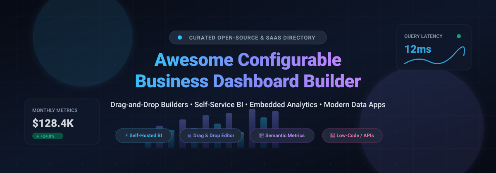

<div align="center">

<a href="assets/banner.svg">
  
</a>

# 📊 Awesome Configurable Business Dashboard Builder

**A Curated Directory of Enterprise SaaS Solutions & Open-Source Dashboard Frameworks**  
*Empowering modern data teams with drag-and-drop dashboard creation, self-service business intelligence (BI), semantic metrics, and embedded analytics.*

<br/>

<a href="https://github.com/ishandutta2007/Awesome-Awesome-Awesome"></a><a href="https://discord.gg/jc4xtF58Ve"></a>
[](https://github.com/ishandutta2007/Awesome-Configurable-Business-Dashboard-Builder/stargazers)
[](https://github.com/ishandutta2007/Awesome-Configurable-Business-Dashboard-Builder/network/members)
[](https://github.com/ishandutta2007/Awesome-Configurable-Business-Dashboard-Builder/blob/main/README.md#how-to-contribute)
[](https://creativecommons.org/publicdomain/zero/1.0/)
<a href="https://github.com/ishandutta2007"></a>

<br/>

[🌟 Key Highlights](#-key-highlights) • [📈 Sector Overview](#-sector-overview--market-dynamics) • [💼 SaaS Platforms](#-saashosted-platforms) • [💻 Open-Source Repositories](#-open-source-github-projects) • [🤝 Contribution](#-how-to-contribute) • [⭐ Star History](#-star-history) • [☕ Support](#-support)

</div>

---

## 🧭 Overview & SEO Summary

**Configurable Business Dashboard Builders** are specialized data platforms that allow analysts, product managers, and developers to assemble interactive, production-ready operational dashboards from heterogeneous data stores (SQL databases, data lakes, APIs, cloud warehouses) without writing boilerplate front-end code.

Whether you require a scalable **drag-and-drop visual dashboard builder**, **embedded white-label analytics** for multi-tenant SaaS products, a **governed semantic layer** (LookML, Cube), or **self-hosted open-source BI** to retain data privacy, this directory provides a side-by-side technical and economic breakdown of the leading solutions.

### 🌟 Key Highlights
- 🎯 **Self-Service Business Intelligence**: Empower non-technical stakeholders to slice, filter, and drill into business KPIs.
- 🧩 **Drag-and-Drop Authoring**: Rapid assembly of charts, KPI cards, tables, maps, and real-time alerts.
- 🔒 **Data Governance & Semantic Layer**: Centralized business metric calculations ensuring consistent metrics across teams.
- ⚡ **Embedded Analytics**: Clean SDKs, iframe embeds, and low-latency APIs to surface dashboards inside customer apps.
- 💰 **Cost Transparency**: Granular breakdown of SaaS base pricing, user seat models, and self-hosted open-source options.

---

## 📑 Table of Contents
- [📈 Sector Overview & Market Dynamics](#-sector-overview--market-dynamics)
- [💼 SaaS/Hosted Platforms](#-saashosted-platforms)
- [💻 Open-Source GitHub Projects](#-open-source-github-projects)
- [🤝 How to Contribute](#-how-to-contribute)
- [⭐ Star History](#-star-history)
- [☕ Support](#-support)
- [📜 Disclaimer](#-disclaimer)

---

## 📈 Sector Overview & Market Dynamics

The global Business Intelligence and configurable dashboard software market is currently estimated between **$27 billion and $33 billion** (projected to reach over **$60 billion by 2032** at an **~8.5% CAGR**). 

The sector features a distinct **hybrid market structure**:
1. **Concentrated Enterprise Core (Oligopoly at the Top)**: Mega-cap tech conglomerates—notably **Microsoft (Power BI)**, **Salesforce (Tableau)**, and **Google Cloud (Looker)**—capture over 40% of the enterprise spend. Their dominance stems from enterprise suite bundling (Microsoft 365, Azure Fabric, Salesforce Data Cloud, Google BigQuery) and massive partner networks.
2. **Moderately to Highly Fragmented Long-Tail**: Outside the tech titans, hundreds of independent vendors and active open-source platforms compete across specialized segments including embedded customer-facing analytics (Sisense, GoodData), live TV monitoring (Geckoboard), agile growth metrics (Databox), and developer-centric code-first BI (Cube, Lightdash, Evidence).

---

## 💼 SaaS/Hosted Platforms

| Product | 🏢 Company Scale (Valuation / Revenue) | 📝 Description | 🏷️ Starting Pricing | 🎁 Free Tier / Trial Limits |
|---|---|---|---|---|
| **[Microsoft Power BI](https://powerbi.microsoft.com/)** | ~$3.9T Market Cap / ~$346B Annual Revenue (Parent: Microsoft) | Microsoft's enterprise BI platform with desktop authoring, cloud publishing, and embedded analytics across Microsoft 365 and Azure environments. | **$14/user/month** (Power BI Pro plan, annual commitment) | **Free forever**: Power BI Desktop (local authoring, no cloud sharing); **60-day free trial** for Power BI Pro/PPU with full platform capabilities |
| **[Looker (Google Cloud)](https://looker.com/)** | ~$2.1T Market Cap / ~$471B Annual Revenue (Parent: Alphabet) | Enterprise BI and semantic data modeling platform (LookML) enabling governed self-service metrics and centralized data definitions. | **$5,000/month** (Standard Platform, includes 1 production instance, 10 Standard users, 2 Developer users; or $9/user/mo for Looker Studio Pro) | **No free forever tier**; **30-day free trial** via Google Cloud sales/sandbox with evaluation data limits |
| **[Tableau](https://www.tableau.com/)** | ~$176B Market Cap / ~$45B Annual Revenue (Parent: Salesforce) | Visual analytics platform with drag-and-drop dashboard authoring, rich chart libraries, and extensive enterprise database connectors. | **$75/user/month** (Tableau Creator, billed annually; requires min. 1 Creator) | **Free forever**: Tableau Public (public dashboards only, 10GB storage limit, no private data); **14-day free trial** for Tableau Cloud Creator |
| **[Icertis Dashboard Builder](https://www.icertis.com/)** | ~$3B+ Valuation / ~$100M+ ARR (Privately held) | Configurable executive and operational dashboard builder embedded inside the Icertis Contract Intelligence (CLM) platform. | **$150/user/month** (estimated starting rate for enterprise CLM tier; typical minimum annual contract $100k+) | **No free forever tier**; **No self-serve free trial** (access only through custom guided sales pilot/demo) |
| **[Domo](https://www.domo.com/)** | ~$100M Market Cap / ~$320M Annual Revenue (Public: DOMO) | Cloud BI & ETL platform featuring drag-and-drop data pipelines (Magic ETL), dashboard widgets, and real-time business apps. | **$30,000/year** (~$2,500/month consumption-based starter tier with ~9,200 consumption credits, unlimited user seats) | **No free forever tier**; **30-day free trial** with full platform capabilities, unlimited users, and no credit card required |
| **[Sisense](https://www.sisense.com/)** | Former $1B+ Unicorn / ~$80M ARR (Privately held) | Embedded analytics and self-service BI platform specialized in white-label customer-facing application dashboards. | **$25,000/year** (~$2,083/month starting package for Self-Serve deployment tier) | **No free forever tier**; **7-day free trial** for self-serve sandbox evaluation with sample data connections |
| **[GoodData](https://www.gooddata.com/)** | ~$40M ARR / ~$150M Total Raised (Privately held) | Cloud-native embedded analytics engine featuring a semantic layer, metric modeling, and workspace-based multi-tenancy. | **$1,500/month** (Professional tier, billed annually; includes unlimited users per workspace) | **Free forever**: Community Edition (self-hosted container for up to 5 users); **30-day free trial** for cloud platform with full AI/analytics features |
| **[Klipfolio](https://www.klipfolio.com/)** | ~$20M ARR (Privately held) | Real-time business KPI dashboard platform featuring 100+ native data connections and flexible metric formulas. | **$120/month** (Klips Base Plan, billed annually at $1,440/year; includes 3 dashboards, unlimited users, 4-hour refresh) | **Free forever plan**: PowerMetrics Free tier (limited to 1 user, 3 dashboards, 10 metrics); **14-day free trial** for Klips dashboard builder |
| **[Databox](https://databox.com/)** | ~$15M ARR (Privately held) | Business dashboard and performance tracking platform designed for marketing, sales, and agency KPI reporting. | **$47/month** (Starter plan, billed annually; includes 5 users and 5 data source connections) | **Free forever**: Free plan with 3 users, 3 data sources, 3 dashboards, and daily data refresh; **14-day free trial** for Starter/Professional tiers |
| **[Geckoboard](https://www.geckoboard.com/)** | ~$10M ARR (Privately held) | Lightweight KPI dashboard designer optimized for live wall-mounted office TVs, team monitors, and mobile tracking. | **$60/month** (Essentials plan, billed annually at $720/year; includes 1 dashboard and 1 editor) | **No free forever tier**; **14-day free trial** with full access to 90+ data sources, unmetered viewer links, and TV pairing |

---

## 💻 Open-Source GitHub Projects

| Project | ⭐ GitHub_Stars | 📝 Description |
|---|---|---|
| **[Grafana](https://github.com/grafana/grafana)** | [](https://github.com/grafana/grafana/stargazers) | The open and composable observability and data visualization platform. Visualizes metrics, logs, and traces from 100+ data sources with dynamic dashboards, alerting, and plugins. |
| **[Apache Superset](https://github.com/apache/superset)** | [](https://github.com/apache/superset/stargazers) | Modern, enterprise-ready business intelligence web application. Features a drag-and-drop dashboard builder, rich visualization palette, SQL Lab for ad-hoc querying, and granular role-based access. |
| **[NocoDB](https://github.com/nocodb/nocodb)** | [](https://github.com/nocodb/nocodb/stargazers) | Open-source smart spreadsheet-database alternative to Airtable. Connects to PostgreSQL, MySQL, and SQL Server to build custom dashboard views, Kanban boards, forms, and automated business workflows. |
| **[Metabase](https://github.com/metabase/metabase)** | [](https://github.com/metabase/metabase/stargazers) | Intuitive open-source BI and self-service analytics platform for everyone. Provides a point-and-click query builder, interactive dashboards, scheduled reports, and one-click embedded analytics. |
| **[Appsmith](https://github.com/appsmithorg/appsmith)** | [](https://github.com/appsmithorg/appsmith/stargazers) | Open-source low-code platform to build internal applications, operational dashboards, and admin panels. Drag-and-drop UI widgets connect to databases, GraphQL, or REST APIs. |
| **[ToolJet](https://github.com/ToolJet/ToolJet)** | [](https://github.com/ToolJet/ToolJet/stargazers) | Low-code open-source framework for building internal business tools, executive dashboards, and workflows. Connects to relational databases, Google Sheets, cloud storage, and APIs. |
| **[Directus](https://github.com/directus/directus)** | [](https://github.com/directus/directus/stargazers) | Open-source data platform that wraps any SQL database with a real-time GraphQL/REST API and an intuitive Insights dashboard builder with drag-and-drop charts and KPI cards. |
| **[Redash](https://github.com/getredash/redash)** | [](https://github.com/getredash/redash/stargazers) | Open-source query and visualization tool built for SQL-first teams. Compose queries with autocomplete, visualize datasets into interactive dashboards, and configure proactive threshold alerts. |
| **[Cube](https://github.com/cube-js/cube)** | [](https://github.com/cube-js/cube/stargazers) | Universal semantic layer for building data applications and configurable dashboards. Provides centralized metric definitions, caching, access control, and SQL/REST/GraphQL APIs. |
| **[ILLA Builder](https://github.com/illacloud/illa-builder)** | [](https://github.com/illacloud/illa-builder/stargazers) | Low-code platform with drag-and-drop dashboard components and AI agent integrations. Quickly connect databases and APIs to generate responsive internal dashboards. |
| **[Evidence](https://github.com/evidence-dev/evidence)** | [](https://github.com/evidence-dev/evidence/stargazers) | Code-driven business intelligence tool. Build interactive, data-driven reports and dashboards using markdown, SQL, and reactive web components with version-controlled CI/CD workflows. |
| **[Lightdash](https://github.com/lightdash/lightdash)** | [](https://github.com/lightdash/lightdash/stargazers) | Open-source BI platform natively integrated with dbt. Translates dbt models and semantic metrics into self-service dashboards without writing separate SQL, featuring an AI analyst copilot. |
| **[Lowdefy](https://github.com/lowdefy/lowdefy)** | [](https://github.com/lowdefy/lowdefy/stargazers) | Config-driven web framework for building internal tools, web apps, and business dashboards using YAML or JSON schema files on Next.js. |
| **[Rill](https://github.com/rilldata/rill)** | [](https://github.com/rilldata/rill/stargazers) | Fast, BI-as-code dashboard framework powered by DuckDB. Rapidly transforms data warehouse tables into interactive, low-latency exploratory dashboards defined via code. |
| **[LobsterBoard](https://github.com/curbob/LobsterBoard)** | [](https://github.com/curbob/LobsterBoard/stargazers) | Self-hosted drag-and-drop dashboard builder with live system monitoring and 45 widgets. Persists layout to config.json with CPU/memory, Docker, and AI cost tracking widgets. |
| **[Dashboard Studio (Rust + WASM)](https://github.com/automataIA/dashboard-studio-rs)** | [](https://github.com/automataIA/dashboard-studio-rs/stargazers) | Privacy-first, client-side data visualization powered by Rust + WebAssembly. Upload CSV data, create dashboards with 11 chart types, drag-and-drop layout, and auto-save to localStorage. |
| **[DashForge](https://github.com/plexusone/dashforge)** | [](https://github.com/plexusone/dashforge/stargazers) | JSON-first dashboard framework with a drag-and-drop visual builder. Starts simple with static hosting and scales to multi-tenancy, SSO, Cube semantic layer, and AI widget generation. |

---

## 🤝 How to Contribute

Contributions are welcome and appreciated! To maintain high resource quality:

1. 🍴 **Fork the repository** to your personal GitHub account.
2. 🌿 **Create a branch** for your feature or update:
   ```bash
   git checkout -b feature/add-new-dashboard-tool
   ```
3. 📝 **Add or edit entries in `README.md`** following the existing tabular structure (ensure proper pricing details, free tier limits, Stars_Badges, and links).
4. ✅ **Ensure accuracy**: Verify links, pricing plans, and open-source licenses before submitting.
5. 🚀 **Open a Pull Request** describing your additions and why they benefit the community.

---

## ☕ Support

If you find this curated directory helpful, please consider supporting the project:

- ⭐ **Star this repository** to help others discover it on GitHub.
- 🍴 **Fork it and share** with data engineering, analytics, and product communities.
- 💬 **Join our discussions** and contribute reviews or feedback on new tools.
- ☕ **Buy a coffee & sponsor**: Support ongoing research, maintenance, and curation via the [GitHub Sponsor Dashboard](https://github.com/sponsors/ishandutta2007).

---

## ⭐ Star History

[](https://www.star-history.com/#ishandutta2007/Awesome-Configurable-Business-Dashboard-Builder&type=date&legend=top-left)

---

## 📜 Disclaimer

- This is a **community-curated** list — not exhaustive and not an official product endorsement.
- Configurable dashboard builders directly connect to production data stores; always enforce strict row-level security (RLS), multi-factor authentication (MFA), role-based access control (RBAC), and audit logging.
- SaaS pricing, packaging, and free-tier limits change over time; verify current details directly on vendor pricing pages before procurement.

---

<div align="center">

**Built with ❤️ for business analysts, analytics engineers, product teams, and software architects.**  
*Empowering developers and organizations to build better, faster, and more accessible dashboard solutions.*

</div>
